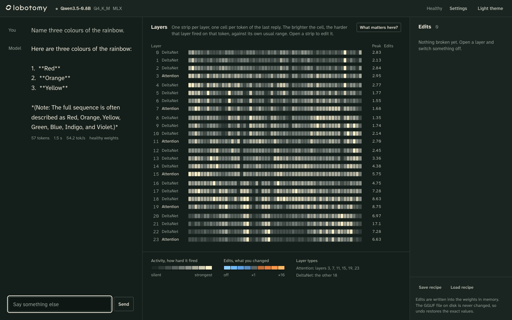

# lobotomy

Break a small LLM on purpose, live, while you chat with it, and see inside it to
choose what to break.

Chat with the model, look at which neurons fired in which layer, switch neurons,
heads or whole layers off (or turn them down, boost them, add noise), then ask
again and see what changed. Every edit can be undone exactly.

The default model is **Qwen3.5 0.8B** (Unsloth's Q4_K_M GGUF). It runs locally
on Apple Silicon through MLX, at about 50 tokens/s on an M2 Pro with every
neuron recorded. A CUDA backend has a slot but isn't written yet.


## Quick start (Apple Silicon)

```bash
uv venv --python 3.13 .venv
uv pip install --python .venv/bin/python -e ".[mlx,dev]"
scripts/download_model.sh            # ~533 MB into models/
.venv/bin/lobotomy serve             # then open http://127.0.0.1:7860
```

The first start dequantizes the GGUF and caches the result in `models/.cache/`
(about 20 s); later starts take about 2 s.

**Bigger model.** Qwen3.5 2B works too (about 33 tokens/s, 5.5 GB of RAM):

```bash
scripts/download_model.sh Qwen3.5-2B-Q4_K_M.gguf     # ~1.3 GB
.venv/bin/lobotomy serve --model models/Qwen3.5-2B-Q4_K_M.gguf
```

Qwen3.5 4B and larger use more DeltaNet value heads than key heads. llama.cpp
reorders those heads when it converts the model, and lobotomy doesn't undo that
yet, so it refuses to load them.

## The web UI

- **3D layers.** Next to the chat, the 24 layers are stacked as sheets of
  neurons. Every word the model writes climbs through them, and lines reach out
  to the neurons that fired on it, thicker for harder firing. The timeline
  underneath plays, pauses and steps through the reply: Shift ← → moves one
  word, ← → one layer. While the model writes, the sheets light up live. Click a
  sheet to pull it out, then a neuron to edit it. The timeline then lights up
  wherever that neuron fired. The 3D / Activity / Lens switch brings back the 2D
  strips.
- **Chat.** Replies stream in; every word is clickable. In *Activity* mode the
  layer stack shows one strip per layer and one cell per word, lit by how hard
  that layer fired. **What matters here?** cuts each layer alone and shows how
  much the answer would change.
- **Lens.** Switch the layer stack from *Activity* to *Lens*. Each cell then
  shows how sure that layer already was of the word the model said next (the
  logit lens), so you can see at which depth the answer appears. In 0.8B,
  nothing shows before about layer 14.
- **Layer.** All 3,584 MLP neurons as a 64 × 56 grid, the heads, and the
  strongest neurons with the word each peaked on. Click anything to edit it:
  off, a log slider from ×1/16 to ×16, boost, noise, reset. The popover shows
  the neuron's activity across the reply and which tokens it pushes up or down.
- **Word.** Click a word to see which layers and neurons fired on it, where each
  attention head looked, the candidates the model considered, and the logit
  lens (what each layer would have said next).
- **Why this word?** One gradient pass ranks all 86,016 neurons and 336 heads by
  how much each pushed the model toward that word (the estimated drop in its
  log-probability if cut). **Make it stop saying it** switches off the top ten.
- **Compare.** Ask again and the answers sit side by side, with the token where
  they split marked. Ask again reuses the seed, so differences come from your
  edits.
- **Erase a token.** Zero a token's embedding row. The embedding is shared
  with the output layer, so the model can neither read nor say that token
  ("The capital of France is the city of Versailles").
- **Edits rail.** Every edit with a note on why you made it, undo, back to
  healthy, and save or load recipes as JSON. The damage meter in the top bar
  shows how far the edited model is from the healthy one (KL divergence on the
  latest reply), live while you edit.
- **Presets.** One-click starting points: *Emoji soup* (all attention off),
  *Broken record* (DeltaNet layers 4–6 off, so it loops), *Overexcited*,
  *Fever dream* and *Tipsy*.
- **Keep memory.** By default each reply re-reads the whole chat with the
  current weights. Untick "Re-read the whole chat" to keep the model's memory
  of earlier turns as it read them before your edits; only new words then come
  from the broken model.
- Shortcuts: `/` focuses the message box, ⌘Z undoes the last edit, ⌘↵ asks
  again.





"Why this word?" on *Canberra*, then *Make it stop saying "Canberra"*, then
*Ask again*:


What every number means (damage, cut cost, attribution, the lens), with a way
to check each one yourself: [docs/how-it-works.md](docs/how-it-works.md).

The visual design (tokens, logos, mockups) is in [design/](design/DESIGN.md).

## The terminal interface

```bash
.venv/bin/lobotomy chat
```

```
> What is the capital of France?
The capital of France is Paris.
  (7 tokens, 54 tok/s, prompt 24)

> /layer 0
#1 L0: off
> /again
- of,,,th isinginginginging…
> /damage
mean KL from healthy: 1.520 nats
> /undo
> /again
The capital of France is Paris.
```

Type `/help` for every command: `/neuron`, `/head`, `/layer`, `/noise`, `/token`,
`/topoff`, `/again`, `/healthy`, `/damage`, `/scan`, `/layers`, `/top`, `/lens`,
`/says`, and saving or loading edit recipes.

## What you can break

| Target | What changes | Effect |
|---|---|---|
| neuron (layer, n) | row `n` of `mlp.up_proj` | scales that neuron's activation, and its effect, exactly |
| head (layer, h) | the head's columns of the output projection | scales that head's contribution to the residual stream |
| layer (layer, all/mixer/mlp) | output projection and/or `mlp.down_proj` | 0 makes the layer pass its input straight through |
| token (id) | that row of the embedding | tied to the output head, so it changes reading *and* saying the token |
| weight (any tensor, rows/cols) | a raw slice | anything else |

Operations: **scale** (0 = off, 0.5 = turn down, 2 = boost) and **noise**
(Gaussian, relative to the slice's RMS, seeded).

Edits are writes into the in-memory weights. The GGUF on disk is never touched.
Each edited tensor keeps a pristine copy and is rebuilt from it plus all active
edits, so undoing any edit, in any order, is exact.

Each reply re-reads the whole chat with the current weights. "Ask again" reuses
the first answer's seed, so a different answer comes from the edits, not from
sampling luck.

## Qwen3.5 0.8B, briefly

24 layers. Layers 3, 7, 11, 15, 19 and 23 use regular attention (8 heads, 2 KV
heads, head dim 256, gated output). The other 18 are **Gated DeltaNet**: linear
attention that carries a running state instead of a KV cache (16 heads of 128).
Every layer has a SwiGLU MLP with 3,584 neurons.

## Layout

```
src/lobotomy/
  gguf_loader.py    GGUF → float weights with Hugging Face names and conventions
  tokenizer.py      tokenizer and chat template, built from the GGUF alone
  edits.py          what you can break, and how it maps onto weights
  engine.py         chat, ask again, edits, damage, scans, attribution, logit lens
  presets.py        starter recipes
  analysis.py       layer activity, top neurons, sparklines
  sampling.py       numpy sampler shared by all backends
  backends/
    base.py         the backend contract
    mlx/            Apple Silicon (done)
    cuda/           NVIDIA (stub)
  cli.py            terminal interface
  server.py         local JSON API + streamed chat for the web UI
  web/              the web UI (plain ES modules, no build step)
tests/              pytest; test_backend_contract.py runs against any backend
```

## Tests

```bash
.venv/bin/python -m pytest -q
```

The reference tests compare against mlx-lm's own Qwen3.5 on the official
weights. They are skipped unless the official checkpoint is in
`models/qwen3.5-0.8b-hf/` (`config.json`, `tokenizer.json` and the safetensors
from `Qwen/Qwen3.5-0.8B`).

## Writing the CUDA backend

Implement `lobotomy.backends.base.Backend` in `backends/cuda/backend.py`; the
docstring there has a suggested route. Then run the contract tests:

```bash
LOBOTOMY_TEST_BACKENDS=cuda python -m pytest tests/test_backend_contract.py tests/test_engine.py
```

## Credits

The MLX model follows mlx-lm's Qwen3.5 implementation and uses its Metal
gated-delta kernel (MIT, Apple). The 3D view uses three.js r170 (MIT), vendored
in `web/vendor/three/`. Weights: Qwen3.5 by the Qwen team (Apache-2.0),
quantized by Unsloth.
