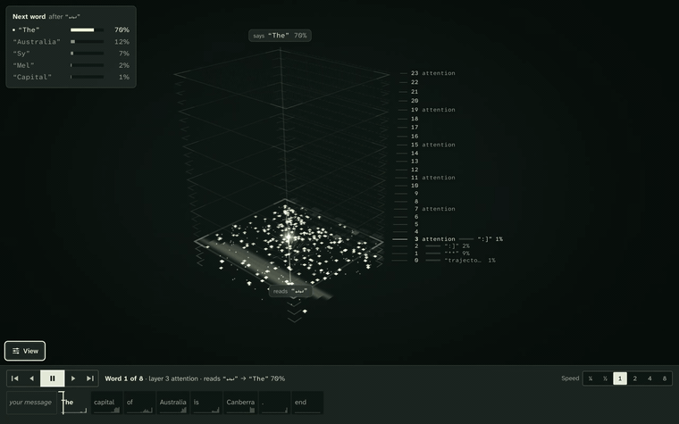
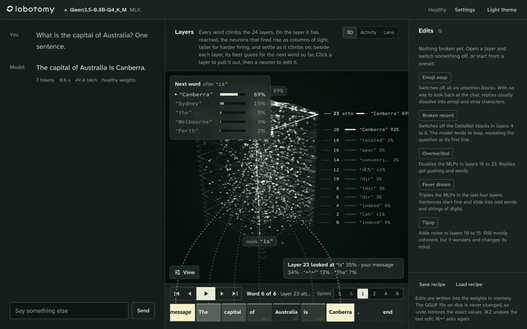
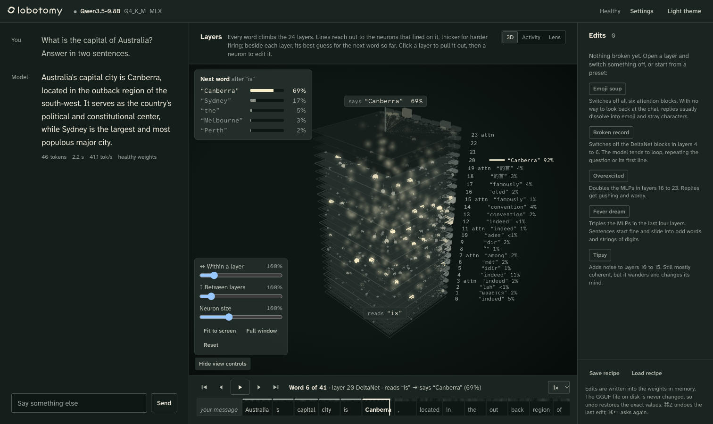
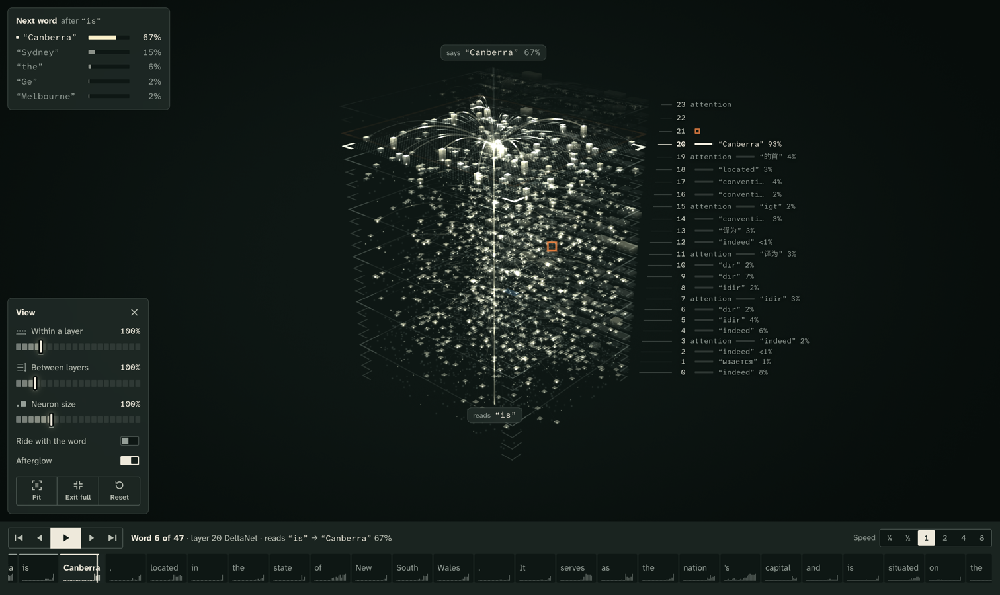
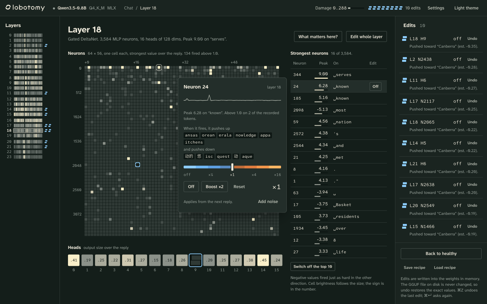
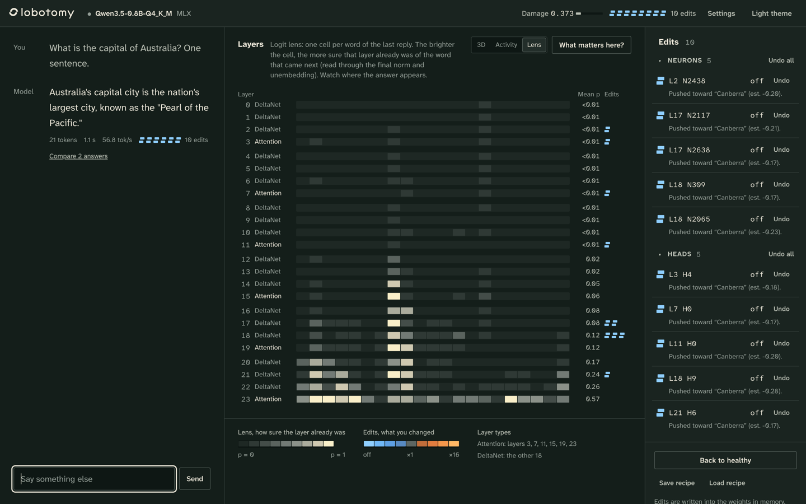
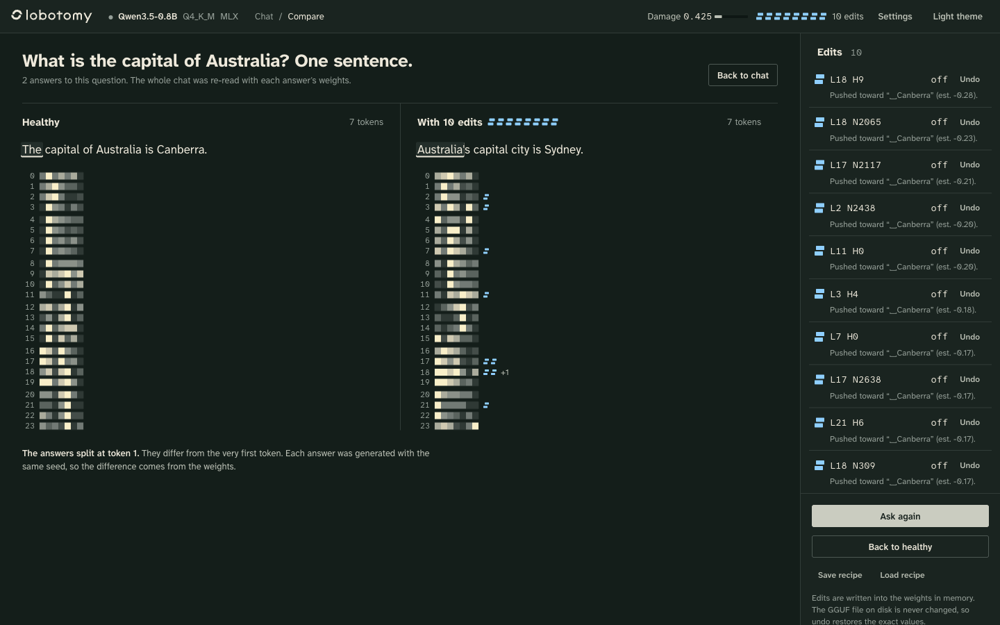

<h1 align="center">
  <picture>
    <source media="(prefers-color-scheme: dark)" srcset="src/lobotomy/web/img/mark-on-dark.svg">
    
  </picture>
  lobotomy
</h1>

<p align="center">
  Break a small language model on purpose, live, while you chat with it,<br>
  and see inside it to choose what to break.
</p>

<p align="center">
  
</p>

## Try it

**macOS or Linux:** paste this into a terminal:

```bash
curl -fsSL https://raw.githubusercontent.com/Vasiniks/lobotomy/main/install.sh | bash
```

**Windows:** paste this into PowerShell:

```powershell
powershell -ExecutionPolicy ByPass -c "irm https://raw.githubusercontent.com/Vasiniks/lobotomy/main/install.ps1 | iex"
```

It sets everything up in `~/lobotomy`, downloads the model (~533 MB) and opens
the app in your browser. The first start takes about 20 s; Ctrl-C stops it.
Next time:

```bash
lobotomy run              # web UI, opens browser (alias: serve --open)
lobotomy run Qwen3.5-2B-Q4_K_M.gguf   # 2B model, downloads if missing
```

`lobe` is a short alias for `lobotomy`, so `lobe run` works too. On Windows,
use `~\lobotomy\.venv\Scripts\lobotomy.exe run`. Run the install line again to
update, and delete the `lobotomy` folder to remove it.

If `zsh: command not found: lobe`, restart your terminal or run
`export PATH="$HOME/.local/bin:$PATH"` — the installer puts `lobe` in
`~/.local/bin`.

What the scripts ([install.sh](install.sh), [install.ps1](install.ps1)) do, so
you can trust them:
- they write into the `lobotomy` folder in your home folder, plus `lobotomy`
  and `lobe` symlinks into `~/.local/bin`, and [uv](https://docs.astral.sh/uv/)
  into `~/.local/bin` if you don't have it; no admin rights
- the app listens on 127.0.0.1 only, so nothing else on your network can reach
  it; there is no account and no telemetry, and the only download is the model
  from Hugging Face
- edits change the weights in memory; the model file on disk never changes

**Where it runs.** lobotomy has two engines that run the same model the same
way, and the installer picks one:

| Machine | Engine | Speed (0.8B) |
|---|---|---|
| Apple Silicon Mac (M1 or later) | MLX on the Apple GPU | about 50 words a second |
| Windows or Linux with an NVIDIA GPU | PyTorch on CUDA | not measured yet |
| Any other Windows or Linux PC, Intel Mac | PyTorch on the CPU | a few words a second |

The PyTorch engine passes the same tests as the MLX one and gives the same
answers (checked on a Mac's CPU, where its predictions match MLX's to within
rounding). It hasn't been run on an NVIDIA GPU or on Windows yet, so if you
try it there, please [open an issue](https://github.com/Vasiniks/lobotomy/issues)
with how it went.

It needs about 2.5 GB of disk and 2–3 GB of free memory, or video memory on an
NVIDIA GPU (*Why this word?* on a long reply briefly needs about 8 GB).

## What it does

You chat with the model and watch every word climb through its 24 layers.
Find the neurons, heads or layers that matter, switch them off, turn them
down, boost them or add noise, then ask again and see what changed. Every edit
is a write into the weights in memory, and every edit undoes exactly.

<p align="center">
  
</p>

The model is **Qwen3.5 0.8B** (or the 2B), running locally on your own
machine, through [MLX](https://github.com/ml-explore/mlx) on Apple Silicon or
[PyTorch](https://pytorch.org) elsewhere, with every neuron recorded as it goes.

## Install by hand

The one-line install runs these steps for you (without the test tools). You
need Python 3.11 or newer; the commands use [uv](https://docs.astral.sh/uv/).

```bash
git clone https://github.com/Vasiniks/lobotomy.git && cd lobotomy
uv venv --python 3.13 .venv
uv pip install --python .venv/bin/python -e ".[mlx,dev]"     # Apple Silicon
# or, anywhere else (picks the CUDA build of PyTorch for your NVIDIA driver, or the CPU build):
# uv pip install --python .venv/bin/python -e ".[torch,dev]" --torch-backend auto

.venv/bin/lobotomy run               # web UI, opens browser
.venv/bin/lobotomy run Qwen3.5-2B-Q4_K_M.gguf   # or a specific model, downloads if needed
```

`lobe` is a short alias, so `lobe run` works everywhere. Other commands:

```bash
lobotomy help                  # overview
lobotomy help run              # help for a single command
lobotomy status                # backends, Python, models on disk, binaries
lobotomy list                  # alias: models — local .gguf files
lobotomy chat                  # terminal chat with /neuron, /layer, etc.
lobotomy serve --port 7860     # web UI, same as `run` but no auto-open
```

On Windows the paths are `.venv\Scripts\python.exe` and
`.venv\Scripts\lobotomy.exe`. `--backend torch` runs the PyTorch engine on a
Mac too, and `--device cpu` (or `cuda:1`) picks where it runs.

The first start takes about 20 s while it converts the weights (see below).
Later starts take about 2 s. `--port` picks another port, and Ctrl-C stops it.

## How the model is loaded

There's no Ollama and no llama.cpp runtime. lobotomy reads a **GGUF file** and
runs the model itself:

1. `lobotomy download` (or `scripts/download_model.sh`) fetches Unsloth's `Qwen3.5-0.8B-Q4_K_M.gguf`, a
   4-bit file, from Hugging Face.
2. `gguf_loader.py` opens it with the `gguf` Python package (llama.cpp's file
   reader) and **expands every weight to floating point**. It also undoes the
   changes llama.cpp's converter makes (norms stored as `w + 1`, `A_log`
   stored as `-exp(A_log)`, renamed tensors), so the weights match the official
   Hugging Face checkpoint. The tokenizer and chat template come out of the
   same file.
3. The engine (MLX, or PyTorch) holds the weights as **bfloat16** on the GPU
   (float32 on a CPU) and runs its own Qwen3.5 forward pass. That pass records every MLP neuron, every head and
   (on attention layers) where each head looked.
4. The converted weights are cached as `models/.cache/*.safetensors`
   (1.5 GB). That cache is why later starts are fast.

Full-precision weights are what make the editing work. Switching a neuron off
writes zeros into a float matrix. Inside a 4-bit runtime, small scales would
get lost in the quantization. The GGUF on disk is never modified.

**Bigger model.** Qwen3.5 2B works too, at about 33 words a second and 5.5 GB
of memory:

```bash
scripts/download_model.sh Qwen3.5-2B-Q4_K_M.gguf     # ~1.3 GB
.venv/bin/lobotomy serve --model models/Qwen3.5-2B-Q4_K_M.gguf
```

lobotomy refuses to load Qwen3.5 4B and larger. Those models have more DeltaNet
value heads than key heads, llama.cpp reorders those heads when it converts the
model, and lobotomy doesn't undo that yet.

## The web UI

### Watch it think (3D)



- **The tower.** The 24 layers are stacked sheets of neurons (3,584 each on
  the 0.8B, 6,144 on the 2B), faint lattices on a dark stage; attention layers
  get a full frame. Every word the model writes climbs through them. On the
  layer the word has reached, the neurons that fired rise as columns of light,
  taller for harder firing, with arcs reaching out to them; behind the word
  they settle into small lit tiles, so the tower stays readable. While the
  model writes, the tower lights up live.
- **The timeline** underneath plays, pauses and steps through the reply: a word
  is a big step, a layer is a small one.
- **Where the answer comes from.** The *Next word* card lists the 5 words the
  model weighed, with its own probabilities. Beside each layer is that layer's
  best guess so far (the logit lens), so you can watch the answer form as the
  word climbs. In the screenshot, "Canberra" first appears at layer 20, at 93%.
- **Pull a layer out.** Click a sheet and it comes forward, facing you. Click a
  neuron to edit it. The timeline then lights up wherever that neuron fired, and
  lines run to the later neurons it feeds (solid boosts, dashed suppresses).
  The heads are the tiles along each sheet's far edge. On an attention layer,
  lines run down into the timeline to the words it looked at.
- **Your edits show in the tower.** Edited neurons get a square ring in their
  edit's colour, and their column takes it: blue for turned down, orange for
  boosted, cut through for off. They flash and ripple when you change them,
  and whole-layer edits tint the sheet. Point at an edit in the edits rail and
  a beacon rises from it.
- **View controls** on the stage: *Within a layer* spreads the neurons apart,
  *Between layers* spreads the layers, and *Neuron size* sets how big each
  neuron is drawn. *Ride with the word* moves the camera up with the word,
  close in; *Afterglow* keeps the last words faintly lit. *Fit* frames the
  whole tower at 90% of the view (it does this on its own until you orbit or
  zoom). *Full window* (F) gives the tower the whole page:

  
- **Each word in the timeline** carries 24 tiny bars: how sure each layer
  already was of that word.
- The 3D / Activity / Lens switch brings back the 2D strips.

### Break it

- **Edits.** Neurons, heads, whole layers (or just a layer's mixer or MLP), and
  token embeddings. Each can be switched off, scaled on a log slider from ×1/16
  to ×16, boosted, or given noise.
- **The edits rail** sorts every edit into neurons, heads, layers, tokens and
  raw weights, each group foldable and in layer order, with the note on why
  you made it. Click an edit to tweak it in place: the scale slider from off
  to ×16, quick values, or the noise strength. Undo one or a whole group, go
  back to healthy, or save and load the set as a JSON recipe.
- **The damage meter** in the top bar shows how far the edited model is from
  the healthy one (KL divergence on the latest reply), live while you edit.
- **Presets** are one-click starting points:
  - *Emoji soup*: all attention off
  - *Broken record*: DeltaNet layers 4–6 off, so it loops
  - *Overexcited*
  - *Fever dream*
  - *Tipsy*
- **Erase a token** zeroes its embedding row. The embedding is shared with the
  output layer, so the model can neither read nor say that token ("The
  capital of France is the city of Versailles").

### Find what to break

- **Why this word?** Click any word, then *Find what pushed it here*. One
  gradient pass ranks all 86,016 neurons and 336 heads by how much each pushed
  the model toward that word. **Make it stop saying it** switches off the top
  ten.
- **What matters here?** cuts each layer (or each neuron and head of a layer)
  alone and measures how much the answer would change.
- **Layer view.** All 3,584 neurons of a layer as a 64 × 56 grid, the heads,
  and the strongest neurons with the word each peaked on. A neuron's popover
  shows its activity across the reply and which tokens it pushes up or down.
- **Word view.** Which layers and neurons fired on a word, where each attention
  head looked, the candidates, and the logit lens.
- **Lens.** In the 2D strips, each cell shows how sure that layer already was
  of the word the model said next. In 0.8B, nothing shows before about layer 14.

| Layer view: layer 18, its three edited units ringed in blue | Lens: where each layer started to know the next word |
|---|---|
|  |  |

### Compare

**Ask again** re-reads the whole chat with the current weights and reuses the
first answer's seed. A different answer therefore comes from your edits, not
from sampling luck. The answers sit side by side, with the word where they
split marked.



*Why this word?* on "Canberra", then *Make it stop saying it*, then *Ask again*.

Untick "Re-read the whole chat" in Settings to keep the model's memory of
earlier turns as it read them before your edits. Only new words then come from
the broken model.

### Shortcuts

| Key | What it does |
|---|---|
| `/` | focus the message box |
| ⌘Z | undo the last edit |
| ⌘↵ | ask again |
| Space | play or pause the 3D timeline |
| ← → | one layer back or forward |
| Shift ← → | one word back or forward |
| F | full window on or off |
| Esc | put a pulled-out layer back, then leave full window |

The 3D / Activity / Lens switch also brings back the 2D strips: [screenshot](docs/screenshots/chat.png).

What every number means (damage, cut cost, attribution, the lens, the 3D
lines, wiring and guesses) is explained in
[docs/how-it-works.md](docs/how-it-works.md), with a way to check each one
yourself. The visual design is in [design/](design/DESIGN.md).

## The terminal interface

```bash
.venv/bin/lobotomy chat
```

```
> What is the capital of France?
The capital of France is Paris.
  (7 tokens, 54 tok/s, prompt 24)

> /layer 0
#1 L0: off
> /again
- of,,,th isinginginginging…
> /damage
mean KL from healthy: 1.520 nats
> /undo
> /again
The capital of France is Paris.
```

`/help` lists every command:
- edits: `/neuron`, `/head`, `/layer`, `/noise`, `/token`, `/topoff`
- asking: `/again`, `/healthy`
- looking: `/damage`, `/scan`, `/layers`, `/top`, `/lens`, `/says`
- saving and loading edit recipes

## What you can break

| Target | What changes | Effect |
|---|---|---|
| neuron (layer, n) | row `n` of `mlp.up_proj` | scales that neuron's activation, and its effect, exactly |
| head (layer, h) | the head's columns of the output projection | scales that head's contribution to the residual stream |
| layer (layer, all/mixer/mlp) | output projection and/or `mlp.down_proj` | 0 makes the layer pass its input straight through |
| token (id) | that row of the embedding | tied to the output head, so it changes reading *and* saying the token |
| weight (any tensor, rows/cols) | a raw slice | anything else |

There are two operations:
- **scale:** 0 is off, 0.5 turns it down, 2 boosts it.
- **noise:** Gaussian, relative to the slice's RMS, seeded.

Each edited tensor keeps a pristine copy and is rebuilt from it plus all
active edits, so undoing any edit, in any order, is exact.

## Qwen3.5 0.8B, briefly

- **24 layers.**
- **Attention:** layers 3, 7, 11, 15, 19 and 23 use regular attention, with 8
  heads, 2 KV heads, head dim 256 and a gated output.
- **DeltaNet:** the other 18 use Gated DeltaNet, a linear attention that
  carries a running state instead of a KV cache, with 16 heads of 128.
- **MLP:** every layer has a SwiGLU MLP with 3,584 neurons.

## Layout

```
src/lobotomy/
  gguf_loader.py    GGUF → float weights with Hugging Face names and conventions
  tokenizer.py      tokenizer and chat template, built from the GGUF alone
  edits.py          what you can break, and how it maps onto weights
  engine.py         chat, ask again, edits, damage, scans, attribution, lens, 3D flow
  presets.py        starter recipes
  analysis.py       layer activity, top neurons, sparklines
  sampling.py       numpy sampler shared by all backends
  backends/
    base.py         the backend contract
    mlx/            Apple Silicon (Metal)
    pytorch/        NVIDIA GPUs (CUDA) and the CPU
  cli.py            terminal interface
  server.py         local JSON API + streamed chat for the web UI
  web/              the web UI: plain ES modules, no build step; js/views/stack3d.js is the 3D view
tests/              pytest; test_backend_contract.py runs against any backend
install.sh          the one-line installer
scripts/            download_model.sh (resumes and retries)
docs/               how-it-works.md (every number), design.md (decisions), screenshots
design/             design system: tokens, logo, mockups
```

## Tests

```bash
.venv/bin/python -m pytest -q        # 72 tests, about a minute
LOBOTOMY_MODEL=models/Qwen3.5-2B-Q4_K_M.gguf .venv/bin/python -m pytest -q   # the same tests on another GGUF
```

The reference tests compare against mlx-lm's own Qwen3.5 running the official
weights. They are skipped unless the official checkpoint is in
`models/qwen3.5-0.8b-hf/` (`config.json`, `tokenizer.json` and the safetensors
from `Qwen/Qwen3.5-0.8B`) and is the same size as the model under test.

## The two engines

`backends/base.py` is the contract; both engines implement it and record the
same internals, so the engine, edits, server and UI don't know which one runs.

- **MLX** (`backends/mlx`): Apple Silicon, with mlx-lm's Metal kernel for the
  DeltaNet layers.
- **PyTorch** (`backends/pytorch`): the same model, line for line, in plain
  PyTorch, with the DeltaNet recurrence written out one token at a time, so it
  runs anywhere PyTorch does. It picks CUDA when it can see an NVIDIA GPU and
  the CPU otherwise. In float32 its predictions match the MLX engine's to a KL
  of about 1e-10, and its answers word for word.

Run the tests against either:

```bash
LOBOTOMY_TEST_BACKENDS=torch .venv/bin/python -m pytest -q
```

## Credits

- **MLX model:** follows mlx-lm's Qwen3.5 implementation and uses its Metal
  gated-delta kernel (MIT, Apple). The PyTorch model is a port of it.
- **3D view:** three.js r170 (MIT), vendored in `web/vendor/three/`.
- **Weights:** Qwen3.5 by the Qwen team (Apache-2.0), quantized to GGUF by
  Unsloth.
